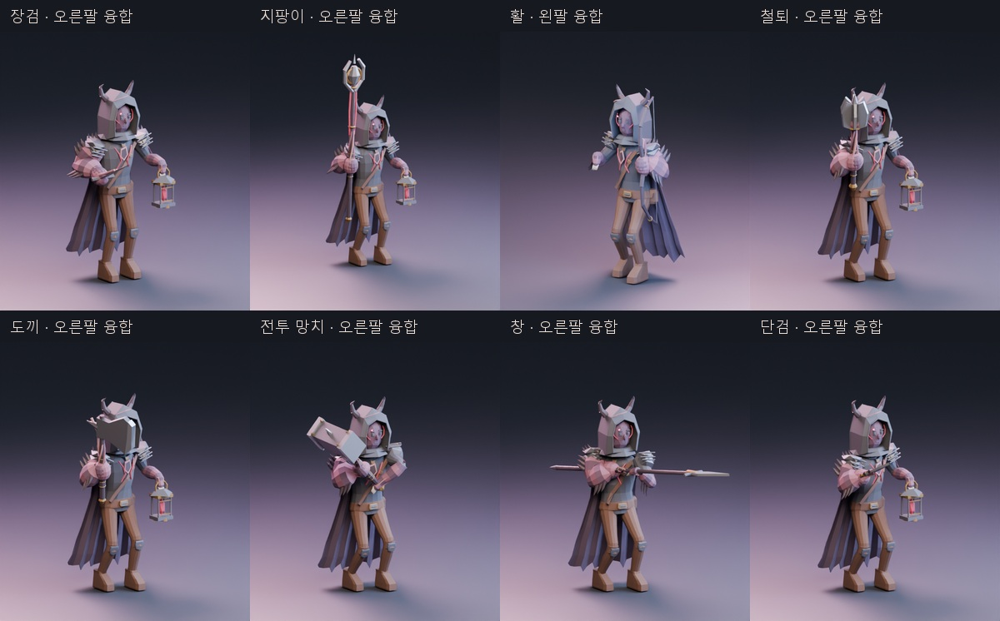

# 오염된 주인공 — 무기 융합 모듈 v1

2026-11-24. 반복된 죽음으로 오염된 주인공을 무기 8종에 맞춰 제작했다. 5등신 체형과 후드·견갑·망토를 유지하면서 살이 갈라진 얼굴, 가슴의 균열, 뼈 돌기와 무기를 감싸는 조직을 추가했다. 무기가 붙은 위팔·팔꿈치·전완·손목을 함께 부풀려 비대칭 실루엣을 만들었다. 전완 중간의 살집 반경은 반대편의 약 2배이며 철퇴와 망치는 더 크다. 돌기는 이 비교에서 제외했다.

[팔과 무기의 연결 부위 확대](previews/fusion_details.jpg). 모두 최종 GLB를 다시 불러와 렌더했다.

## 전달 파일

| 파일 | 용도 |
|---|---|
| `hero_corruption_v1.blend` | 모델·웨이트·33본 리그·키프레임 원본. 기본 표시 형태는 장검 |
| `hero_corrupted_parts.glb` | 공용 몸통과 8종 융합 파트 전체 40메시, 전체 49개 본 애니메이션 |
| `hero_corrupted_base.glb` | 공용 몸통 17메시·비융합 팔 2개·선택 램프 2개, 전체 본 애니메이션 |
| `modules/corrupted_<kind>_module.glb` | 무기와 융합 팔만 포함하는 스킨 모듈 8개. 애니메이션 없음 |
| `assembled/hero_corrupted_<kind>.glb` | 무기별 완성형 8개. 공통 및 해당 무기 동작 포함 |
| `corruption_catalog.json` | 무기 키·파트 인덱스·표시/숨김 목록·리그·클립 정보 |
| `validation.json`, `playback_validation.json`, `bow_validation.json` | 형상·스킨·애니메이션과 활 변형 재생 검사 |
| `delivery_files.json` | 최종 전달 파일 및 참조 원본의 SHA-256 |

전체 파트 라이브러리는 조립을 위한 파일이다. 모든 메시를 표시하면 서로 다른 무기와 팔이 겹친다. 완성형 GLB는 바로 열어 검토할 수 있다. 조립 후 삼각형 수는 무기에 따라 8,507~9,833개다.

## 무기별 선택

좌우는 캐릭터 기준이다. `module_index`는 이 팩 내부 순서다. 게임의 무기 배열 순서 대신 `weapon_key`로 조회한다.

| 인덱스 | 무기 / kind | weapon_key | 융합 팔 | 반대 손 |
|---|---|---|---|---|
| 0 | 장검 / longsword | `HERO_Longsword` | 오른팔 | 램프 |
| 1 | 지팡이 / staff | `WPN_Staff_00_CinderCrook` | 오른팔 | 램프 |
| 2 | 활 / bow | `WPN_Bow_00_ThornRecurve` | 왼팔 | 시위 당기기 |
| 3 | 철퇴 / mace | `WPN_Mace_00_FlangedIron` | 오른팔 | 램프 |
| 4 | 도끼 / axe | `WPN_Axe_00_Riven` | 오른팔 | 램프 |
| 5 | 전투 망치 / warhammer | `WPN_Hammer_00_Warden` | 오른팔 | 보조 파지 |
| 6 | 창 / spear | `WPN_Spear_00_AshPike` | 오른팔 | 보조 파지 |
| 7 | 단검 / dagger | `WPN_Dagger_00_Rondel` | 오른팔 | 램프 |

장검과 단검은 손목에서 검의 뿌리로 조직이 이어지고, 지팡이·철퇴·도끼·망치·창은 손잡이를 뼈와 힘줄이 감싼다. 활은 왼손의 활대 손잡이에 조직을 더했다. 기존 무기의 길이와 날·망치 타격면은 유지했다. 망치·창의 보조 손 파지 공간과 활의 당김 동작을 유지한다.

## 모듈 조립 규칙

파트 인덱스는 `parts[].part_index`에 있으며 GLB 노드 extras와 Blender 오브젝트에도 같은 값을 기록했다. 이름은 `CORR_` 접두사를 사용한다. 같은 40개 메시를 공유하며 무기별로 몸 전체를 새로 만들지 않는다.

1. `weapon_key`로 `modules[]`에서 하나를 고른다.
2. 전체 라이브러리를 쓸 때는 `assembly_parts` 또는 `assembly_part_indices`에 있는 메시만 표시한다.
3. 베이스와 개별 모듈을 쓸 때는 베이스의 `show_base_parts`를 표시하고 `hide_base_parts`를 숨긴 다음 `parts`를 추가한다. 융합 쪽 비융합 팔과, 양손 무기의 램프가 숨겨진다.
4. 별도 파일의 스킨을 합칠 때 각 메시의 관절 인덱스를 하나의 공용 리그에 연결한다. 파일별 리그를 독립적으로 재생하지 않는다. 공통 발바닥 원점·이동 0·회전 0·스케일 1로 조립한다.
5. 무기 전환 시 이전 모듈을 제거하고 새 선택 목록을 적용한다. 일반 주인공과 오염된 주인공은 전체 외형 프리셋으로 교체한다.

`hide_normal_parts`는 일반 모델과 비교할 때의 대체 부위 정보다. 이것만으로 일반 주인공 일부를 숨기는 방식보다 이 팩의 조립 목록 전체를 사용하는 것이 기준이다. 완성형 GLB에는 이미 해당 선택이 적용되어 있다.

단위는 미터다. Blender는 Z 위·정면 -Y, GLB는 Y 위·정면 +Z다. 몸체 높이는 1.84m이며 후드의 새 돌기는 그 위로 더 올라간다.

## 리깅·애니메이션

현재 5등신 주인공의 `RIG_HERO_HoodedLantern` 33본과 바인드 행렬을 그대로 사용했다. 팔의 비대화에는 위팔·전완·손·무기 본 웨이트를 나누어 사용했다. 추가 본은 없다. 기존 49개 본 애니메이션의 시간·값·보간 데이터를 원본 그대로 연결했다. 걷기와 달리기는 각각 하나이며 방향 회전은 게임 로직에서 처리한다.

완성형 장검에는 공통 11개와 장검 스킬 1개가 있다. 다른 무기는 공통 11개와 해당 무기 전용 클립을 포함하며 활은 18개, 나머지는 16개다. 개별 모듈은 정적 스킨 파일이므로 베이스나 라이브러리의 공용 리그 애니메이션과 함께 사용한다.

활의 `Draw` 변형과 화살의 `Hide` 변형은 원본 시위·장전·발사 키프레임에 연결했다. 기본값은 활대/시위 Draw=0, 화살 Hide=1이다. 무기 전환 또는 활 클립 종료 시 이 기본값을 복원한다. 본 동작과 함께 morph weights 채널도 재생해야 한다. Blender 원본에는 같은 클립 이름의 shape key NLA 트랙이 있다.

[장검 공격](previews/longsword_motion.gif) · [망치 대지강타](previews/warhammer_motion.gif) · [활 당기기](previews/bow_motion.gif)

## 검증과 적용 인계

18개 GLB의 본 이름·순서·바인드·웨이트·조립 부위·파트 인덱스를 검사했다. 49개 본 클립 및 활 변형 채널을 원본과 비교했다. 8개 완성형의 모든 클립을 재수입해 팔 관절과 무기 연결점을 구간별로 검사했고, 활의 준비·당김·조준·발사·스킬 변형도 확인했다. 각 결과 파일의 `all_checks_passed`는 true다. 이는 지정 클립과 표본 포즈에 대한 검사이며 게임에서의 지형 접촉과 임의 클립 간 전환은 적용 시 확인한다.

현재 게임은 오염 임계값 `MutationThreshold`(현재 100)에 도달하면 `MutatedHuman` / `MON_03_*` 외형과 동작을 사용한다. 이 팩의 장비별 외형 선택은 후속 게임 적용 작업에서 연결해야 한다. 이 작업은 모델·리깅·애니메이션 전달까지이며 게임 코드와 빌드는 포함하지 않는다.

## 재생성

Blender 5.2에서 `scripts/build_corruption.py`를 실행하고 일반 Python으로 `attach_animations.py`, Blender로 `sync_metadata.py`를 차례로 실행한다. 원본은 `Hero_v1`, `HeroWeaponAnimations_v1` 및 `CharacterQuality_20261123/scripts/mesh_quality.py`를 참조한다. 원본 파일을 변경하지 않는다.

검사는 일반 Python의 `validate_corruption.py`, Blender의 `validate_playback.py`와 `verify_bow.py`로 수행한다. Blender의 `render_corruption.py -- animate` 뒤 Pillow가 있는 Python의 `compose_previews.py`로 미리보기를 만든다. 마지막에 `finalize_delivery.py`로 조립 목록과 체크섬을 갱신한다. 다른 프로세스가 GLB를 읽고 있을 때에는 재생성하지 않는다.
